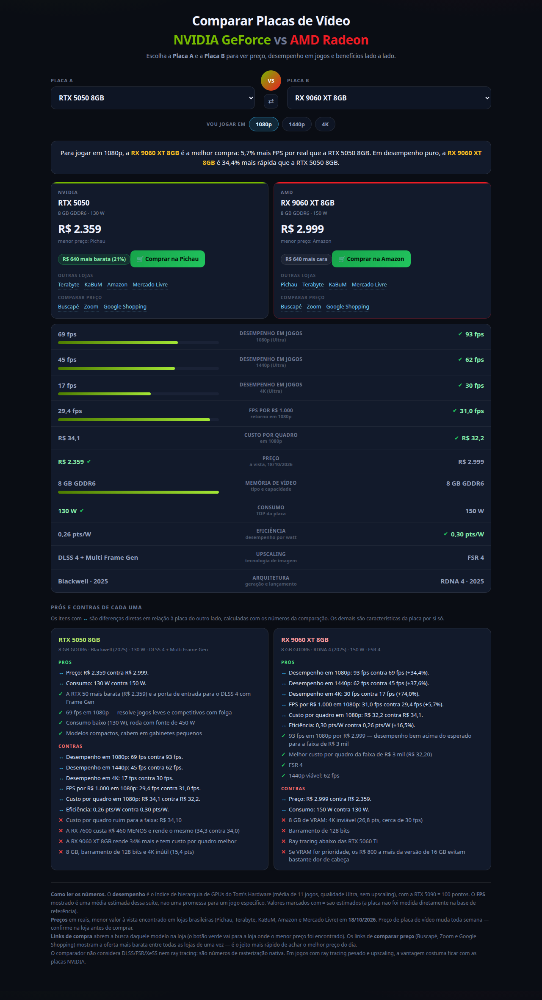

# Comparador de Placas de Vídeo — AMD vs NVIDIA

Comparador de placas de vídeo pensado para o **mercado brasileiro**, com foco em
**custo-benefício para jogos**: escolha duas placas e veja preço, desempenho e
prós e contras, lado a lado.

🔗 **Versão online:** https://tarcisiotna.github.io/comparador-placa-de-video/



## Sobre

É um **arquivo HTML único**, sem build, sem servidor e sem dependência de
internet. Baixe, dê duplo clique e funciona — inclusive offline.

## O que dá para fazer

- **Duelo 1x1** — escolha a Placa A e a Placa B (o botão ⇄ inverte as duas) e
  receba o veredito em uma frase.
- **Resolução alvo** — os botões 1080p, 1440p e 4K ajustam o custo por quadro e
  o veredito.
- **Comparação métrica a métrica** — 11 quesitos (FPS em três resoluções, FPS por
  R$ 1.000, custo por quadro, preço, memória de vídeo, consumo, eficiência,
  upscaling e arquitetura), com barras e quem vence marcado com ✔.
- **Prós e contras de cada placa** — mistura as diferenças medidas naquela
  comparação (marcadas com ↔) com uma análise própria de cada uma das 19 placas.
- **Posição na Steam** — cada placa mostra a sua colocação na Pesquisa de Hardware
  da Steam (a lista das GPUs de desktop mais usadas pelos jogadores) e o
  percentual de PCs. A posição também entra na tabela de comparação.
- **Links de compra** — botão para a loja onde o menor preço foi encontrado,
  links para as outras lojas e para os comparadores de preço (Buscapé, Zoom e
  Google Shopping).

## Estrutura

| Arquivo | O que é |
| --- | --- |
| `index.html` | O comparador A vs B. É a página inicial. |
| `painel-completo.html` | Painel com gráficos (dispersão preço × desempenho, fronteira de Pareto, custo-benefício, eficiência), faixas de preço, ranking da Steam e tabela ordenável das 19 placas. |
| `buscador-pcs.html` | Buscador de PCs gamers prontos com preço, ficha técnica, desempenho estimado e link direto da oferta (KaBuM e Amazon). |
| `preview.png` | Imagem de prévia usada neste README. |

## Buscador de PCs prontos

O `buscador-pcs.html` é uma página separada, também HTML único, para quem quer
comprar o computador inteiro em vez da placa avulsa. Ele tem duas abas:

- **Ofertas com preço** — catálogo de PCs gamers prontos com preço à vista,
  processador, RAM, disco, fonte, placa de vídeo e **link direto para o produto**
  na loja. **Só entram máquinas com memória DDR4.** Filtros por faixa de preço,
  marca de CPU/GPU, resolução ideal, loja, ordenação (menor preço, maior preço,
  desempenho ou custo-benefício) e busca textual. Cada card mostra o FPS estimado
  em 1080p, o índice de desempenho e o FPS por R$ 1.000, usando a mesma base do
  comparador (RTX 5090 = 100).
- **Busca por loja** — gera links de busca prontos para Pichau, KaBuM, Magalu,
  Amazon, Terabyte, Mercado Livre, Buscapé, Zoom e Google Shopping. Serve para
  as lojas que bloqueiam coleta automática.

**De onde vêm os preços.** As ofertas são coletadas das páginas públicas de busca
do **KaBuM!** (`__NEXT_DATA__`) e da **Amazon Brasil** (resultados de busca), com
o link do produto montado a partir do código/ASIN. Os preços ficam embutidos no
array `PCS` do próprio HTML e foram coletados em **23/10/2026**. Pichau, Magalu,
Terabyte e Mercado Livre bloqueiam acesso automatizado, então não entram no
catálogo — só na aba de busca.

**Regra do catálogo: só DDR4.** O catálogo lista apenas PCs com memória **DDR4**.
Máquinas com DDR3 ou DDR5 (ou sem geração de memória confirmada) ficam de fora,
mesmo que o preço seja atraente. A geração é identificada pelo nome/descrição do
produto, pela velocidade da memória (até 4000 MHz = DDR4) ou pelo chipset/CPU
(AM4 e Intel 300/400/500 = DDR4).

## Como os números são calculados

**Desempenho.** Índice de hierarquia de GPUs do
[Tom's Hardware](https://www.tomshardware.com/reviews/gpu-hierarchy), média de 11
jogos em qualidade Ultra e sem upscaling, normalizado com a **RTX 5090 = 100
pontos**. Esse índice vira FPS estimado por uma constante por resolução:

| Resolução | FPS da RTX 5090 (índice 100) |
| --- | --- |
| 1080p | 203,7 fps |
| 1440p | 167,2 fps |
| 4K | 110,8 fps |

**Valores estimados.** Quando a placa não tem medição direta na base de
referência, o número aparece marcado com **≈**. Hoje: RX 9050 8GB (nas três
resoluções), RX 6600 (1440p e 4K) e RTX 3050 6GB (4K).

**Custo-benefício.** FPS por R$ 1.000 investidos e custo por quadro (R$ por FPS).
Em preço, consumo e custo por quadro, **menor é melhor**.

**Preços.** Menor valor à vista encontrado em lojas brasileiras (Pichau,
Terabyte, KaBuM, Amazon e Mercado Livre) em **18/10/2026**.

**Popularidade.** Posição na **Pesquisa de Hardware da Steam** de
**setembro/2026** (categoria "Video Card Description"), que mede a fatia de PCs
de jogadores com cada placa. A colocação considera apenas **placas de vídeo de
desktop** — notebooks, gráficos integrados (Intel e AMD), Apple e Steam Deck
ficam de fora. A Steam não separa versões com VRAM diferente (RTX 5060 Ti 8/16 GB
e RX 9060 XT 8/16 GB dividem a mesma posição), e RX 9070 GRE e RX 9050 ainda não
aparecem na pesquisa.

## O que não está incluído

Os números são de **rasterização nativa**. O comparador não considera
DLSS/FSR/XeSS nem ray tracing — dois pontos em que a NVIDIA costuma levar
vantagem. Use os prós e contras de cada placa para pesar isso.

## Como atualizar os preços

Todos os dados ficam no array `GPUS`, no começo do `<script>` do `index.html`.
Cada placa é uma linha:

```js
{ name:"RTX 5050", brand:"NVIDIA", arch:"Blackwell", year:2025, vram:8, mem:"GDDR6",
  tdp:130, price:2359, priceStore:"Pichau", upscaling:"DLSS 4 + Multi Frame Gen",
  steam:{pos:58,pct:0.22}, perf:{p1080:34.0, p1440:27.1, p4k:15.4} },
```

Para atualizar, mude só o `price` e o `priceStore` (a loja onde achou o preço).
A análise de prós e contras de cada placa fica logo abaixo, no objeto `ANALISE`.

O campo `steam` guarda a posição na Pesquisa de Hardware da Steam
(`pos` = colocação entre GPUs de desktop, `pct` = % de PCs). Quando a pesquisa do
mês sai, atualize os dois valores — ou use `steam:null` se a placa não aparecer.
O mesmo array existe no `painel-completo.html` e precisa receber a mesma mudança.

Contribuições com preços atualizados são bem-vindas — só cite a loja e a data.

## Tecnologia

HTML, CSS e JavaScript puros. Sem framework, sem CDN e sem build. O comparador
(`index.html`) tem cerca de 38 KB.

## Licença

[MIT](LICENSE) — use, modifique e distribua à vontade.

## Aviso

Projeto pessoal, sem fins comerciais e sem qualquer vínculo com AMD, NVIDIA ou
com as lojas citadas. As marcas pertencem aos seus respectivos donos. Preço de
placa de vídeo muda toda semana: **confirme na loja antes de comprar**. Os
números de desempenho são estimativas derivadas de benchmarks públicos, não de
testes próprios.
